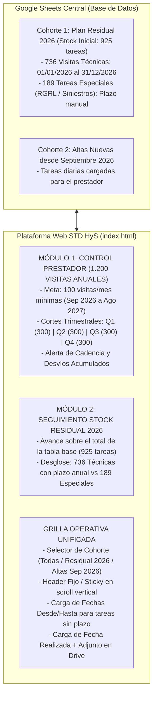

# IAPSER ART · Plataforma de Control y Gestión de Visitas Gerenciadas

Plataforma unificada de gestión, seguimiento de vencimientos, registro de visitas, carga documental y **Tablero Ejecutivo de KPIs HyS** para preventores y el equipo de gestión de **IAPSER ART Gerenciadas**.

Diseñada bajo el estándar visual institucional de Higiene y Seguridad (`IBM Plex Sans / Mono`, `#17202A` / `#0F4C5C` / `#A8470A`), con integración a **Google Sheets** como base de datos centralizada y **Google Drive** para el resguardo mensual estructurado de actas y constancias.

---

## 🎯 Modelo de Gestión y Arquitectura de Doble Cohorte

El sistema implementa una **arquitectura dual de control** para responder tanto a los compromisos institucionales anuales como al control contractual estricto del proveedor:



### 1. Cohorte 1: Plan Residual 2026 (Stock Inicial - 925 tareas)
* **736 Visitas Técnicas**: Tienen su plazo precargado desde el **`01/01/2026`** hasta el **`31/12/2026`** (`Fecha Desde` y `Fecha Hasta`).
* **189 Tareas Especiales** (176 *RGRL / Verosimilitud* y 13 *Siniestros*): Tienen plazos específicos a ingresar manualmente mediante el panel lateral de carga. El sistema las identifica como *Pendiente plazo* hasta que se fijen sus fechas.
* **Métrica**: Avance respecto al total de la tabla actual (`Realizadas / 925`).

### 2. Cohorte 2: Plan de Control del Proveedor (Ciclo Sep 2026 – Ago 2027)
* **Meta Contractual**: **100 visitas efectivas / mes** $\rightarrow$ **1.200 visitas anuales**.
* **Cortes Trimestrales de Compensación**: Diseñados para permitir que un desvío o déficit mensual sea compensado por el proveedor dentro de la ventana del trimestre:
  * **Q1 (Sep 2026 – Nov 2026)**: Meta 300 visitas efectivas acumuladas.
  * **Q2 (Dic 2026 – Feb 2027)**: Meta 600 visitas acumuladas (300 en el Q).
  * **Q3 (Mar 2027 – May 2027)**: Meta 900 visitas acumuladas (300 en el Q).
  * **Q4 (Jun 2027 – Ago 2027)**: Meta 1.200 visitas acumuladas (300 en el Q).
* **Métricas**: Avance acumulado sobre 1.200, ritmo y cadencia vs meta acumulada de 100/mes, tasa de efectividad (efectivas vs fallidas) y evolución mensual.

---

## 🚀 Estructura de Archivos

| Archivo | Descripción |
| :--- | :--- |
| **`index.html`** | Aplicación web principal interactiva. Incluye tabla con **encabezado fijo (sticky header)**, selector de cohortes (*Todas*, *Plan Residual 2026*, *Altas Sep 2026*), columna visual `Origen Plan`, modal de nueva tarea, semáforos, ficha lateral de carga con edición de plazos, dropzone de archivos, detector OCR y el **Tablero Ejecutivo de KPIs HyS**. |
| **`chart.umd.min.js`** | Librería Chart.js incluida localmente para funcionamiento 100% offline. |
| **`datos_precargados.js`** | Base de datos real con los **925 registros** de la planilla de Google Sheets: **736 visitas técnicas con fechas 01/01/2026 a 31/12/2026**, 189 especiales con fechas para carga manual, todas marcadas como `Residual 2026`, con contador inicial limpio (**0 realizadas**). |
| **`codigo_apps_script.js`** | Código backend para **Google Apps Script**. Incluye la columna `Origen Plan`, precarga de fechas 2026 en `inicializarColumnas()`, endpoint `createTask` para altas diarias del proveedor (`Alta Sep 2026`), subida estructurada a Google Drive por mes (`CUIT_Estab_Tarea_YYYYMMDD.ext`), y actualización atómica en Google Sheets. |
| **`planilla_iapser_raw.csv`** | Copia de respaldo en formato CSV de la planilla original de Google Sheets. |

---

## 📌 Control de Versiones con Git y GitHub

El repositorio Git local está inicializado en la rama principal `main` con la configuración del proyecto HyS.

Para vincularlo y sincronizarlo con tu cuenta de GitHub (`guidodragani75-byte`):

1. Crear un nuevo repositorio en GitHub: [https://github.com/new](https://github.com/new) con el nombre (por ejemplo `iapser-gerenciadas`).
2. Vincular el repositorio remoto y subir los cambios:
   ```bash
   git remote add origin https://github.com/guidodragani75-byte/iapser-gerenciadas.git
   git push -u origin main
   ```

---

## ☁️ Instrucciones de Despliegue en Google Sheets & Drive

1. **Abrir la Planilla de Google Sheets:**
   [Prioridad mes vencido IAPSER Gerenciadas](https://docs.google.com/spreadsheets/d/1xXEmPqATmcMR0JpO2IuTmf1YZ6fMRxyeAc9avbfDRqI/edit?usp=drive_link)
2. **Abrir el editor de Apps Script:**
   Ir a **Extensiones** $\rightarrow$ **Apps Script**.
3. **Pegar el Backend:**
   Copiar todo el contenido de [`codigo_apps_script.js`](file:///c:/Users/cript/OneDrive/Escritorio/Antigravity/IAPSER%20Gerenciadas/codigo_apps_script.js) y pegarlo en el editor.
4. **Inicializar Columnas y Fechas 2026:**
   Ejecutar la función `inicializarColumnas`. Esto agregará automáticamente las columnas nuevas (`Origen Plan`, `Fecha Desde`, `Fecha Hasta`, `Fecha Realizada`, etc.) y precargará las fechas `01/01/2026` y `31/12/2026` para todas las filas de `Visita tecnica`.
5. **Implementar como Web App:**
   * **Implementar** $\rightarrow$ **Nueva implementación** $\rightarrow$ Tipo: **Aplicación web**.
   * Ejecutar como: **Yo**; Quién tiene acceso: **Cualquier usuario**.
   * Copiar la URL generada y pegarla en **Configurar Sheets & Drive** en `index.html`.
